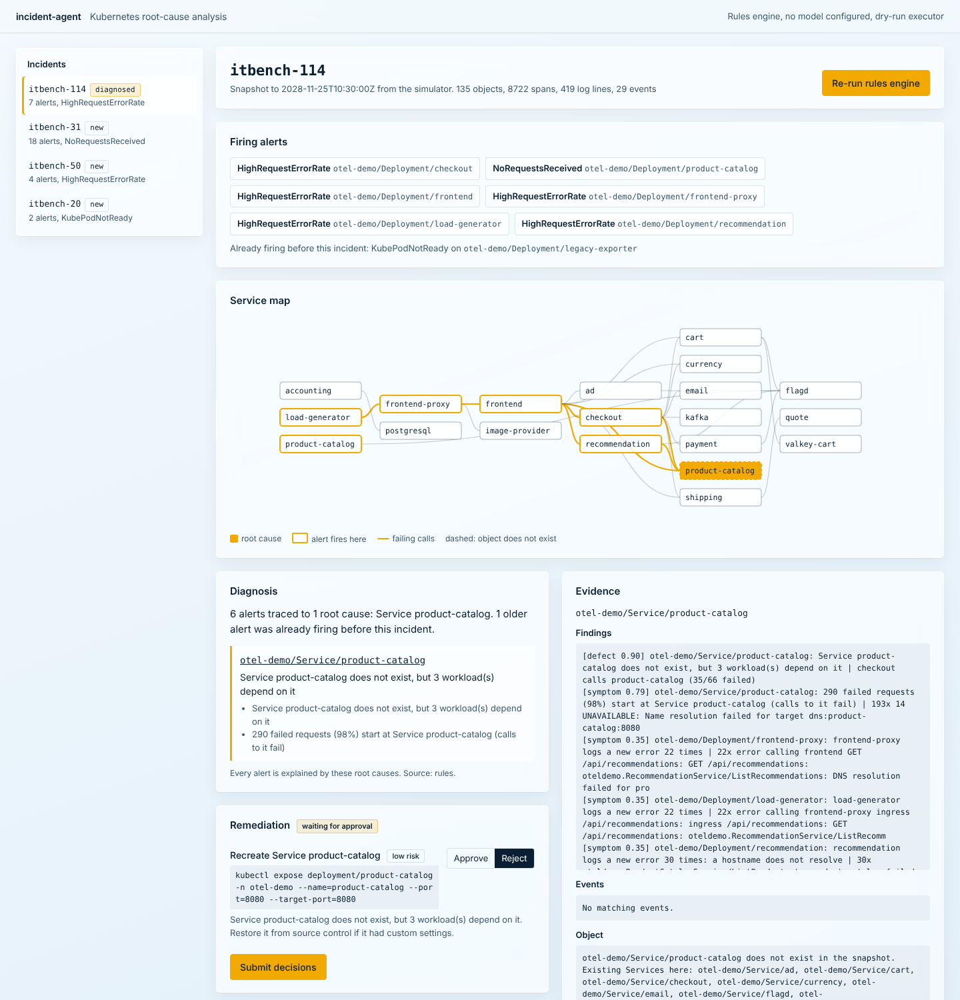

# incident-agent

An on-call agent for Kubernetes incidents. Given alerts, cluster objects, events, logs, traces and metrics, it finds the objects that caused the incident, separates them from the services that are merely failing because of them, proposes kubectl fixes, and runs a fix only after a person approves it.

It runs as a CLI, as a web console, and as an MCP server, so Claude, Cursor or any other MCP client can investigate incidents with the same tools.



## The problem

On-call root-cause analysis is mostly about not being fooled by symptoms.

- **Alerts fire where users notice, not where the fault is.** When the `product-catalog` Service is deleted, the alerts fire on `frontend`, `checkout` and `load-generator`.
- **Plenty else is wrong at the same time.** A workload has been crash-looping for days, a Service has had no endpoints for weeks, and the collector keeps logging export retries.
- **The fix depends on getting the exact object right.** Restarting the frontend does nothing when the cause is a NetworkPolicy.

IBM's [ITBench](https://github.com/itbench-hub/ITBench) turns this into a benchmark: Kubernetes incident snapshots with ground-truth root-cause entities. On [ITBench-AA](https://huggingface.co/blog/ibm-research/itbench-aa) (Artificial Analysis and IBM, May 2026), the best frontier model scores **47%**. Scoring is strict: missing any root cause scores zero, and every extra entity lowers the score.

## How it works

```
alerts, objects, events, logs, traces, metrics   (offline snapshot, or `collect` from a live cluster)
        │
        ▼
Cluster index ─── ownership (Pod→ReplicaSet→Deployment), Service routing, config and policy bindings,
        │         call graph from client spans and *_ADDR env vars, alert → entity mapping
        ▼
Detectors ─────── defects (bad image, OOM, unschedulable, Service with no endpoints or a wrong targetPort,
        │         missing Service, deny-all NetworkPolicy or AuthorizationPolicy, exhausted quota,
        │         maxed-out HPA, strict mTLS with out-of-mesh workloads, namespace leaving the mesh),
        │         changes (rollout diffs, recent edits, bulk object creation), and symptoms
        │         (where failed requests start, where latency is added, new error logs, metric shifts)
        ▼
RCA engine ────── for each new alert, walk the dependency graph in the direction the failure came from;
        │         pick the smallest set of defects that explains every alert; report the object a policy
        │         breaks when the policy targets it; ignore alerts that were firing before the incident
        ▼
LangGraph workflow
   triage ─▶ agent ⇄ tools ─▶ adjudicate ─▶ plan ─▶ approval (interrupt) ─▶ remediate ─▶ report
                ▲                │
                └─── revise ◀────┘  an alert is unexplained, or a stronger defect was left out
```

**The agent** (`agent/graph.py`)
- A LangGraph `StateGraph` with a SQLite checkpointer, so every step is durable. An investigation interrupted mid-way, or paused for approval, resumes from the same point in a new process.
- With a model configured, a ReAct loop runs over eleven read-only tools. The rules engine's candidates are its starting hypotheses, and the model has to confirm or correct them.
  - It also gets the changes that landed shortly before the first alert, from the incident timeline (below).
  - Model adapters for the Anthropic Messages API, OpenAI-compatible chat and Google Cloud Vertex AI (Gemini, or Claude through Vertex) are plain `httpx`.
  - If the model fails or runs out of steps, the workflow falls back to the rules engine.
- `adjudicate` is deterministic. It checks that every proposed root cause exists and that every new alert is explained by one of them. It also checks that no proposed entity is just a symptom of another, and that no stronger defect on an alert's path was left out. Failures go back to the model as specific feedback.
- `approval` uses LangGraph `interrupt()`. Each action shows its exact kubectl command, risk level and whether it can be undone.

**Incident timeline** (`analysis/timeline.py`)
- One ordered view, relative to the first alert of the incident (T0): changes (rollout diffs, edits to config, policy and Services), the first Warning event per object and reason, the first occurrence of each new error log pattern, the first failed call on each service edge, and alert activations.
- A deleted Service leaves no object behind, so its deletion is inferred from client spans: last answered call, then name-resolution failures.
- Changes are ranked as likely triggers by how shortly they landed before T0 and whether an alert's dependency path reaches them. A change no alert can reach is shown, but not ranked. This is correlation and the RCA engine does not use it; on the 30 synthetic scenarios (3 seeds) the top-ranked change is a ground-truth root cause in 72 of 89 runs that have one.
- Available as the `incident_timeline` tool (agent and MCP), `incident-agent timeline`, a section of the incident report, and the console's "What changed" panel.

**Remediation** (`agent/remediation.py`)
- Actions are concrete, for example:
  - `rollout undo` when the latest revision broke the pods;
  - `scale` back to the previous replica count;
  - recreating a deleted Service with `expose`;
  - patching a selector or `targetPort`;
  - deleting a deny-all policy after backing it up;
  - relabelling a namespace back into the mesh.
- The default executor is a dry run. The kubectl executor:
  - runs argument lists, never a shell;
  - only accepts allowlisted verbs;
  - requires a namespace;
  - refuses bulk deletes;
  - backs up anything it patches or deletes;
  - sends `--dry-run=server` unless told otherwise.

**MCP server** (`mcp_server.py`)
- Implements MCP spec 2026-07-28 over stateless Streamable HTTP:
  - `server/discover`;
  - cacheable `tools/list`;
  - `Mcp-Method` / `Mcp-Name` header checks.
- Tools: investigation tools, `diagnose` (also in ITBench `agent_output` format), `plan_remediation` and `run_remediation`.
- `run_remediation` asks for approval through MRTR. The server answers `input_required` with a form elicitation and an HMAC-signed, single-use `requestState`. The client retries with the user's answer, and the server keeps no session in between.

**Console** (`web/`): incidents, new alerts versus chronic ones, the diagnosis with evidence, a service map, approve/reject per action, and the agent's step log.

## Results

### Read this first

**These results are not an ITBench-AA score.** The ITBench-AA snapshots (31 GB) are on Hugging Face, which this build environment could not reach.

**What the evaluation uses instead:**
- IBM's **30 SRE scenario definitions** from the ITBench repository (Apache-2.0, vendored in `src/incident_agent/data/itbench`), with their **real ground-truth root causes and fault mechanisms**.
- A generator in `simulate/` that rebuilds each incident:
  - **Cluster:** the OpenTelemetry demo or Istio Bookinfo, with the fault applied the way the ITBench mechanism applies it.
  - **Telemetry:** traffic and traces with failures propagated along real call paths; error logs in each language's own format; Prometheus-style alerts evaluated over the generated metrics.
  - **Noise:**
    - a workload broken for days, whose alert is still firing;
    - a Service with no backends;
    - an old crash;
    - an unrelated recent config edit;
    - a days-old rollout;
    - routine warnings.

**Scoring:** ITBench-AA's rule, done deterministically. A run scores 0 if any root cause is missed; otherwise it scores its precision. Each scenario runs 3 times with different seeds.

**The split:** scenarios are split by fault mechanism. The engine's thresholds were tuned on **dev** only, and **test** was run once at the end.

**Limit on generalization:** I wrote the detectors knowing all 27 fault types these scenarios use. The held-out split therefore guards against threshold tuning, but it does not show the engine generalizes to fault types nobody has seen. The real check is `incident-agent eval --itbench-data <download>`.

### Synthetic snapshots of the 30 ITBench scenarios

| method | dev (15 scenarios) | test (15 scenarios) |
|---|---:|---:|
| alert targets: blame what the alerts fire on | 0.293 | 0.241 |
| error origin: follow traces to where failed requests start | 0.422 | 0.200 |
| every anomaly: report every entity with a defect | 0.289 | 0.290 |
| **rules engine** | **0.933** | **1.000** |

Full tables with per-scenario results: [`reports/rca-test.md`](reports/rca-test.md), [`reports/rca-dev.md`](reports/rca-dev.md).

What the baselines show:
- **Alerts point at symptoms.** No scenario is solved by blaming alert targets.
- **Following traces finds where errors appear,** which is not where the misconfiguration is.
- **A list of every defect** includes the long-standing breakage, so it is never precise.

The engine's one dev miss is scenario 34. A rotated `valkey-credentials` Secret breaks the cache's clients. The engine reports the Secret, while ITBench's ground truth names the `valkey-cart` Deployment. It is left as is rather than special-cased, and a test documents it.

### Not measured here

- **The LLM investigator.** It needs an API key, which this build did not have. The workflow is tested end to end with scripted models covering:
  - tool use;
  - a wrong answer sent back and revised;
  - step budget;
  - model failure;
  - prose answers.

  To measure it:

  ```bash
  export ANTHROPIC_API_KEY=...
  incident-agent eval --split test --provider anthropic --model claude-sonnet-5-5
  ```

- **Real ITBench snapshots.** The reader follows the column layout in ITBench's ClickHouse recorder (`components/recorders/clickhouse`). All 30 synthetic scenarios survive a round trip through that layout with identical diagnoses, but the reader has not been run on the downloaded dataset. To try it:

  ```bash
  hf download ibm-research/ITBench-Lite --repo-type dataset --include "snapshots/sre/*" --local-dir itbench-lite
  incident-agent itbench-check itbench-lite/snapshots/sre/<version>/Scenario-1   # what the reader loads
  incident-agent eval --itbench-data itbench-lite/snapshots/sre
  ```

## Quickstart

Requires Python 3.10+.

```bash
pip install -e ".[dev]"
pytest -q                                       # 142 tests, offline, about 15 s

incident-agent serve --demo                     # console with all 30 scenarios: http://127.0.0.1:8750
incident-agent scenarios                        # list them with their ground truth

incident-agent simulate 31 --out snapshots      # write one incident snapshot
incident-agent diagnose snapshots/scenario-31   # root causes, evidence, propagation
incident-agent timeline snapshots/scenario-31   # what changed, then what failed, relative to the first alert
incident-agent investigate snapshots/scenario-31 --approve none    # full workflow, reject all actions
incident-agent eval --split test                # baselines vs the engine, writes reports/
```

**With a model:**

```bash
export ANTHROPIC_API_KEY=...                    # or OPENAI_API_KEY with --provider openai
incident-agent investigate snapshots/scenario-31 --provider anthropic --model claude-sonnet-5-5
incident-agent serve --demo --provider anthropic

# Google Cloud Vertex AI: credentials from `gcloud auth application-default login`
export GOOGLE_CLOUD_PROJECT=my-project          # GOOGLE_CLOUD_LOCATION defaults to global
incident-agent investigate snapshots/scenario-31 --provider google                     # Claude on Vertex
incident-agent investigate snapshots/scenario-31 --provider google --model <gemini model id>
```

**On a live cluster.** Snapshot it first. Secret values are never copied.

```bash
incident-agent collect --out snapshots/live --context my-cluster --namespace otel-demo \
    --prometheus http://localhost:9090 --jaeger http://localhost:16686
incident-agent investigate snapshots/live --execute --context my-cluster   # kubectl, --dry-run=server by default
```

**Docker:**

```bash
docker build -t incident-agent . && docker run -p 8750:8750 incident-agent
```

### Connect an MCP client

Point a client at `http://127.0.0.1:8750/mcp`. Tools take an `incident` id from `list_incidents`. For example, `diagnose` returns the root causes in `structuredContent.itbench`. `run_remediation` only runs if the client supports elicitation and the user approves.

## Design choices

- **Deterministic analysis first, the model second.** The rules engine does the bookkeeping that models get wrong under ITBench's scoring: mapping alerts to entities, walking ownership and routing, and keeping chronic problems out. The model's job is to check and overrule it with evidence, and the adjudicator holds the model to the same standard.
- **Precision is part of the design.** Extra entities cost points in ITBench and send on-call engineers in the wrong direction. The engine reports a symptom only when no defect explains an alert.
- **Human approval is structural, not a prompt.** The workflow stops at an `interrupt()`, and the MCP server can only run an action after a signed approval round trip.
- **Snapshots, not live access, for analysis.** A frozen snapshot can be investigated repeatedly, scored, and shared. The live collector produces the same format.

## Limits

- Detectors cover the failure classes in ITBench's SRE library, plus general signals (rollout diffs, recent changes, trace and latency origins). A new class of fault falls back to "where the failure starts", which is right less often.
- Chaos Mesh scenarios from the older ITBench set are not modelled.
- The live collector reads span metrics in the OpenTelemetry demo's naming. Other setups need their PromQL in `collect.py`.
- MCP approval state is single-use per process. Run one replica, or share `INCIDENT_AGENT_STATE_SECRET` and accept replay protection per replica.

## Layout

```
src/incident_agent/
  simulate/   topology.py (OTel demo, Bookinfo) · engine.py (cluster, traffic, telemetry, alerts) · faults.py · scenarios.py
  analysis/   index.py (relationships) · detectors.py (evidence) · rca.py (root cause vs symptom) · timeline.py (changes vs failures)
  agent/      graph.py (LangGraph workflow) · tools.py · remediation.py · llm.py
  eval/       groundtruth.py · scoring.py (ITBench-AA rule) · runner.py (baselines, reports)
  itbench.py (ITBench snapshot reader/writer) · collect.py (live cluster) · mcp_server.py · web/ · cli.py
  data/itbench/  IBM ITBench scenario specs, ground truth and fault definitions (Apache-2.0)
tests/        142 tests: every scenario, detectors, RCA, scoring, the workflow with approval and restart,
              scripted-model runs, MCP approval round trip, console API, collector, CLI
reports/      rca-dev.md · rca-test.md
```

## Credits

The scenario definitions, ground truth and fault mechanisms are from IBM's [ITBench](https://github.com/itbench-hub/ITBench) (Apache-2.0). The grading rule follows the [ITBench-AA](https://huggingface.co/blog/ibm-research/itbench-aa) methodology from Artificial Analysis and IBM.

## License

MIT
